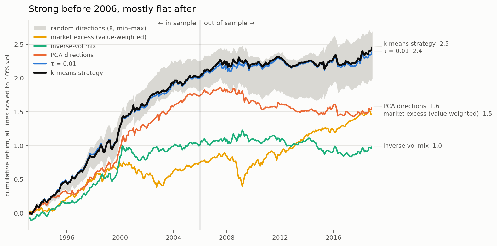
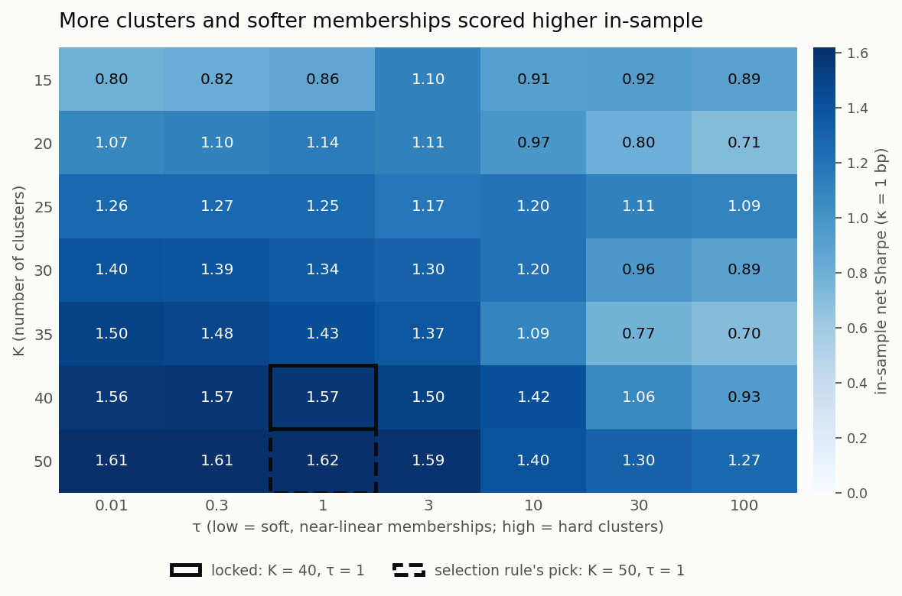
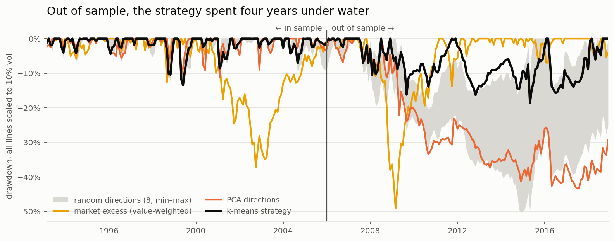
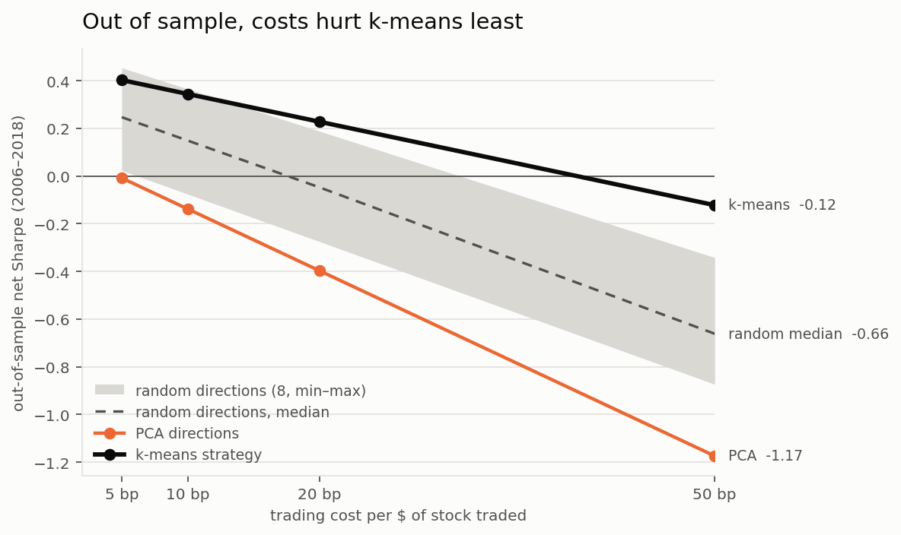
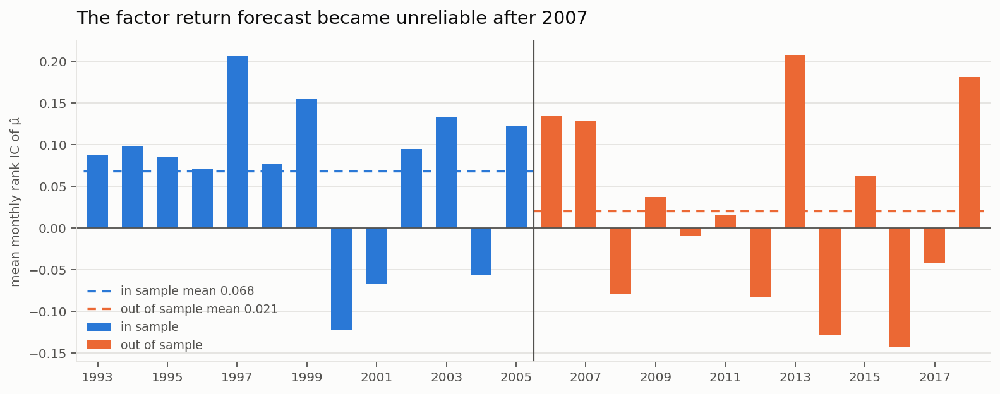

# A Geometric Approach to Factor Modeling

Each month, US stocks were grouped into 40 "firm types" by their characteristics, turn each type into a long-short factor, and trade a risk-budgeted mix of those factors. Everything was tuned on 1990–2005, locked, and then run once on 2006–2018. The method is described in [docs/paper.pdf](docs/paper.pdf).

**TLDR** In sample the strategy earned a net Sharpe of 1.57. Out of sample it earned 0.34, with a 95% interval of −0.20 to 0.89, so it can't be told apart from zero. It also spent 49 months in the red. The return forecast itself stopped working after 2007. What did hold up is the clustering: it trades 30–50% less than random or PCA directions, so it loses the least to trading costs. At 50 bp it beats 5 of 8 random direction sets even after correcting for multiple tests. Before costs, it's no better than random directions.



## How it works

Each month the model takes 74 cleaned firm characteristics, ranks each one to [−1, 1] and scales every firm to unit length. Spherical k-means, fitted on the last three months of firms, groups them into 40 types, and each firm gets a soft membership in every type (softmax of cosine similarity, τ = 1). Each type becomes a dollar-neutral long-short factor. Factor means come from the last 60 months and risk from an exponentially weighted covariance with shrinkage. The optimiser picks factor weights that maximise expected return minus a turnover penalty, within a 10% vol budget, 3× gross exposure and a 0.6 cap per factor. Trading costs are charged at 10 bp per dollar of stock traded.

Data: monthly firm characteristics and returns for US stocks, 1990–2018 (the Gu, Kelly and Xiu dataset), plus the Fama-French factors. The smallest 20% of firms by market cap are dropped each month.

## How it was tested

- **Tuning used in-sample data only (1993–2005).** 2,168 settings were tried and the final one was picked from a broad plateau that was positive in both halves of the period, not the single best cell. Then I locked the config and tagged the code (`pre-oos`).
- **Expectations were written down before the out-of-sample run** (see the scorecard below).
- **The out-of-sample run happened once.** Everything after it is measurement, and anything not planned beforehand is labelled exploratory.
- **Leak tests.** Shuffling returns across stocks within each month drops the gross Sharpe to about zero (−0.17 on average over 8 shuffles). Re-running the code later reproduced every month exactly, and in-sample months come out the same whether the run ends in 2005 or 2018, so later data never leaks into earlier months.



The plateau runs right up to the edge of the grid (K = 50). A larger K might have scored higher in sample.

## Results

<!-- table:headline -->

|                                               | In sample 1993–2005 | Out of sample 2006–2018 |
| --------------------------------------------- | ------------------- | ----------------------- |
| Net Sharpe [95% CI]                           | 1.57 [1.00, 2.14]   | 0.34 [−0.20, 0.89]      |
| t-stat (i.i.d. / Newey-West)                  | 5.64 / 5.66         | 1.24 / 1.43             |
| Return / vol per year                         | 16.6% / 10.6%       | 3.6% / 10.3%            |
| Max drawdown / longest spell under water      | −14.3% / 7 months   | −19.8% / 49 months      |
| Worst month                                   | −11.7%              | −11.9%                  |
| Cost drag per year / stock turnover per month | 1.3% / 1.10         | 1.2% / 1.00             |
| Alpha after FF5 + momentum (t)                | 9.1% (4.12)         | 0.9% (0.35)             |
| Correlation with the market                   | 0.19                | −0.03                   |

<!-- /table:headline -->

Thirteen years is too short to prove absolute performance either way: even the market's excess-return Sharpe (0.55) has an interval that touches zero. That's why the comparisons between methods below are the main part of this report.



### Scorecard against the expectations written before the run

<!-- table:scorecard -->

| Expectation (written before the run)           | Result                        |     |
| ---------------------------------------------- | ----------------------------- | --- |
| Net Sharpe roughly 0.6–1.0                     | 0.34                          | ✗   |
| Positive at 10 bp and 20 bp                    | 0.34, 0.23                    | ✓   |
| Above the inverse-vol mix                      | +0.36                         | ✓   |
| At least the median random run at 20 and 50 bp | 0.23 vs −0.05; −0.12 vs −0.66 | ✓   |
| About equal to random runs at 5–10 bp          | 16 of 16 no difference        | ✓   |
| τ = 0.01 about equal                           | no difference                 | ✓   |
| PCA below after costs                          | +0.48, +0.62                  | ✓   |
| Returns-free features about equal              | no difference                 | ✓   |
| Delisting returns lower Sharpe by about 0.1    | −30%: +0.01; −100%: +0.31     | ✗   |
| Low correlation with the market (below 0.3)    | −0.03                         | ✓   |

<!-- /table:scorecard -->

The headline Sharpe came in well below the expected range. Delisting returns _raised_ the Sharpe out of sample, because the firms that disappeared were held mostly short (0.51% of capital short vs 0.25% long in the −100% run), so the −100% case is not conservative here, and the -30% one should be used instead.

### Does the clustering add anything?

A comparison with methods that each changed one part of the pipeline:

<!-- table:layers -->

| Net Sharpe at 10 bp [95% CI]       | In sample                 | Out of sample              |
| ---------------------------------- | ------------------------- | -------------------------- |
| k-means strategy                   | 1.57 [1.00, 2.14]         | 0.34 [−0.20, 0.89]         |
| τ = 0.01 (near-linear memberships) | 1.56 [0.99, 2.14]         | 0.31 [−0.23, 0.86]         |
| random directions, median of 8     | 1.66 (range 1.38 to 1.80) | 0.15 (range −0.08 to 0.37) |
| PCA directions                     | 1.30 [0.74, 1.86]         | −0.14 [−0.68, 0.41]        |
| inverse-vol mix                    | 0.76 [0.21, 1.31]         | −0.01 [−0.56, 0.53]        |
| diagonal mean-variance mix         | 0.62 [0.07, 1.17]         | 0.05 [−0.50, 0.59]         |
| market excess (value-weighted)     | 0.59 [0.04, 1.14]         | 0.55 [0.00, 1.09]          |

<!-- /table:layers -->

Paired block-bootstrap tests of the Sharpe difference (10k resamples, 6-month blocks). For the 8 random direction sets, p-values are Holm-adjusted within each cost level:

<!-- table:relative -->

| k-means strategy, out of sample       | Cost  | Sharpe difference [95% CI] | Verdict                                   |
| ------------------------------------- | ----- | -------------------------- | ----------------------------------------- |
| vs PCA directions                     | 10 bp | +0.48 [+0.13, +0.85]       | significant                               |
| vs PCA directions                     | 20 bp | +0.62 [+0.29, +0.99]       | significant                               |
| vs inverse-vol mix                    | 10 bp | +0.36 [+0.01, +0.76]       | significant, borderline                   |
| vs diagonal mean-variance mix         | 10 bp | +0.30 [−0.01, +0.64]       | directional, not significant              |
| vs τ = 0.01 (near-linear memberships) | 10 bp | +0.03 [−0.06, +0.12]       | no difference                             |
| vs returns-free features              | 10 bp | −0.05 [−0.13, +0.03]       | no difference                             |
| vs each of 8 random direction sets    | 5 bp  | ranks 2 of 9               | no difference from 8 of 8 after Holm      |
| vs each of 8 random direction sets    | 10 bp | ranks 2 of 9               | no difference from 8 of 8 after Holm      |
| vs each of 8 random direction sets    | 20 bp | ranks 1 of 9               | ahead of 8 of 8; 0 significant after Holm |
| vs each of 8 random direction sets    | 50 bp | ranks 1 of 9               | ahead of 8 of 8; 5 significant after Holm |

<!-- /table:relative -->



## Why it decayed



- The forecast was the problem: μ̂'s rank IC fell from 0.068 (t 2.1) to 0.021 (t 0.6). Costs stayed at 1.0–1.4% a year in every year. Every clearly losing year out of sample (2009, 2012, 2014, 2016) lost money before costs; only 2010 (−0.1%) was tipped negative by costs.
- The strategy wasn't found by luck: The deflated Sharpe of the in-sample result is 0.98 even when all 2,168 settings are treated as independent tries. That count ignores the feature and window choices also made on in-sample data, so the real value is a little lower.
- Out of sample, the returns are mostly from known factors: After FF5 + momentum, alpha is 0.9% a year (t 0.35), and the loadings are small caps (0.32), profitability (0.54) and momentum (0.24). The strategy kept its value and low-accruals tilts but swapped most of its momentum tilt for small, illiquid stocks.
- The 2008 crisis didn't play a role: Without 2008 the Sharpe is 0.37. The weak stretch is 2009–2015, while the market rallied.
- Early 2016: −16.7% in four months. The strategy was short high-beta, recent-loser stocks just as they rebounded. Fama-French factors explain only −1.4% of that loss, so the remaining loss is from the strategy itself.

## Why k-means trades less

- 19 of the 74 characteristics change quickly (month-to-month rank autocorrelation below 0.9): mostly market-based, momentum and quarterly-earnings variables.
- k-means puts less weight on those as compared to random directions: 18.5% against 24–28%. So firms' scores along its directions are steadier month to month (rank autocorrelation 0.955 vs 0.88–0.90).
- All of its turnover saving comes from that stability: Trades caused by firms changing type are 1.03 a month vs 1.35–2.35 for random directions, whereas trades caused by changing factor weights are about the same for both.

## What didn't work

- The absolute return didn't survive out of sample.
- k-means directions don't predict returns better than random ones. Their only measurable advantage is lower turnover.
- The tuned memberships (τ = 1) are effectively linear: τ = 0.01 gives the same result.
- The original mean-variance (γ) optimiser just shrank the same portfolio as γ grew, so it was replaced with a fixed risk budget.

## Limitations

- Delisting returns are missing: Firms that vanish mid-month drop out of the universe, a mild look-ahead (0.57% of stock-months). Sensitivity runs at −30% and −100% are reported above.
- Some feature choices used in-sample returns, but a version built without them performs the same.
- Only used one dataset ending in 2018, with US stocks only.
- Costs are approximated as a flat charge per dollar traded, with no borrowing costs.

## Reproduce

```bash
uv sync
```

```bash
uv run python main.py data && uv run python main.py tune && uv run python main.py benchmarks && uv run python main.py leaktest
```

```bash
uv run python main.py metrics && uv run python main.py attribution && uv run python main.py replay && uv run python main.py compare
```

```bash
uv run python main.py d1 && uv run python main.py d4 && uv run python main.py d8 && uv run python main.py d3 && uv run python main.py d7 && uv run python main.py d6_d5
```

```bash
uv run python main.py figures && uv run python main.py readme
```

The out-of-sample stage (`main.py oos`) refuses to run unless the config matches `results/config_locked.json` and no OOS results exist yet. Raw data goes in `data/raw/` (not included). Decisions and their reasons are logged in [DECISIONS.md](DECISIONS.md). Tables in this README are generated from `results/` by `src/evaluation/readme_tables.py`.

## Next steps

- Test on later data (2019 onward) and non-US markets with the config unchanged.
- Find a better return forecast than the 60-month mean.
- Use k-means' low turnover deliberately, for example as the basis for a cost-sensitive strategy at higher trading costs.
